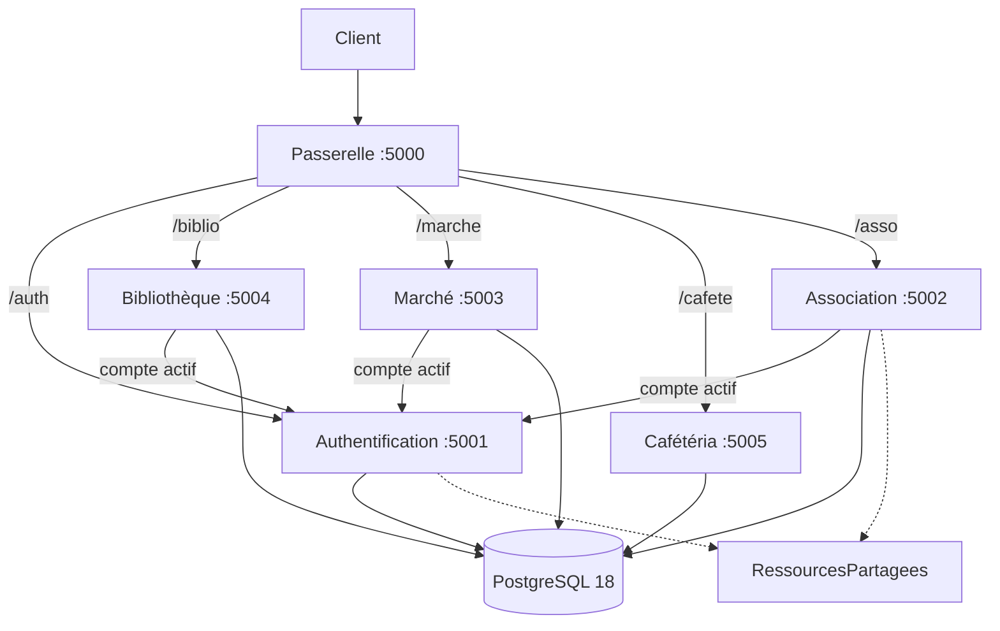

# UQAR Live — API Backend (microservices)

[](https://dotnet.microsoft.com/download/dotnet/8.0)
[](https://www.postgresql.org/)
[](https://github.com/ThreeMammals/Ocelot)
[](https://github.com/AzizAVERIBOU/Api-UqarLive/actions/workflows/ci.yml)

UQAR Live est un projet d'été, supervisé par un professeur. Il prépare l'arrière-plan d'une application qui regrouperait des services de la vie universitaire : les menus de la cafétéria, la réservation de salles, les petites annonces et les activités des associations.

Cette application n'est pas initiée pour le moment. Le menu, une salle, une annonce ou l'activité d'une association ne se trouvent pas au même endroit. Ce dépôt comble ce manque : un compte, puis ces quatre services, derrière une même adresse.

Le backend est en **microservices** : APIs REST en **ASP.NET Core** (.NET 8), routage centralisé via **Ocelot**, persistance **PostgreSQL** avec **Entity Framework Core** et **Npgsql**.

Le dépôt compile la solution et exécute les tests avec **GitHub Actions**. Il n’y a pas de déploiement automatique.

Les six services sont en ligne sur Render : la [passerelle](https://uqarlive-gateway.onrender.com), l’[authentification](https://api-uqarlive.onrender.com), la [bibliothèque](https://uqarlive-bibliotheque.onrender.com), le [marché](https://uqarlive-marche.onrender.com), la [cafétéria](https://uqarlive-cafetaria.onrender.com) et les [associations](https://uqarlive-association.onrender.com). Chaque dossier de service a son propre README.

**Dépôt :** [https://github.com/AzizAVERIBOU/Api-UqarLive](https://github.com/AzizAVERIBOU/Api-UqarLive)

**Liens personnels :** [Portfolio (Vercel)](https://profil-aziz.vercel.app/) · [LinkedIn](https://www.linkedin.com/in/aziz-averibou-51b782323/)

---

## Sommaire

- [Architecture](#architecture)
- [Stack technique](#stack-technique)
- [Structure du dépôt](#structure-du-dépôt)
- [Prérequis et installation](#prérequis-et-installation)
- [Exécution locale](#exécution-locale)
- [Configuration](#configuration)
- [Docker](#docker)
- [Intégration continue](#intégration-continue)
- [Documentation des API](#documentation-des-api)
- [Migrations Entity Framework](#migrations-entity-framework)
- [Contribution et licence](#contribution-et-licence)
- [Auteur](#auteur)

---

## Architecture



| Composant | Rôle | Port local (exemple) |
|-----------|------|-------------------------|
| **Gateway** | Point d’entrée unique, **Ocelot** (`ocelot.json`), Swagger centralisé. [README](Gateway/README.md). Public : [uqarlive-gateway.onrender.com](https://uqarlive-gateway.onrender.com) | `5000` (ou `PORT`) |
| **AuthentificationService** | Comptes, JWT (`JwtBearer`). [README](AuthentificationService/README.md). Public : [api-uqarlive.onrender.com](https://api-uqarlive.onrender.com) | `5001` |
| **AssociationService** | Associations, adhésions, événements. [README](AssociationService/README.md). Public : [uqarlive-association.onrender.com](https://uqarlive-association.onrender.com) | `5002` |
| **MarketService** | Marketplace. [README](MarketService/README.md). Public : [uqarlive-marche.onrender.com](https://uqarlive-marche.onrender.com) | `5003` |
| **BibliothequeService** | Salles et réservations. [README](BibliothequeService/README.md). Public : [uqarlive-bibliotheque.onrender.com](https://uqarlive-bibliotheque.onrender.com) | `5004` |
| **CafetariaService** | Cafétéria, menus et horaires. [README](CafetariaService/README.md). Public : [uqarlive-cafetaria.onrender.com](https://uqarlive-cafetaria.onrender.com) | `5005` |
| **RessourcesPartagees** | Bibliothèque de classes partagée. [README](RessourcesPartagees/README.md) | — |

Chaque service métier a son propre **DbContext**. Les services partagent la même base PostgreSQL, avec un historique de migrations par service.

La passerelle envoie `/auth/…`, `/biblio/…`, `/marche/…`, `/cafete/…` et `/asso/…`. Association, Marché et Bibliothèque appellent `VerifierUtilisateur` pour vérifier qu’un code permanent correspond à un compte actif. La cafétéria n’appelle pas l’authentification.

---

## Stack technique

- **Runtime / framework :** .NET **8.0**, C# avec nullable reference types.
- **ORM :** **Entity Framework Core 9.0.11** + provider **Npgsql.EntityFrameworkCore.PostgreSQL 9.0.4**.
- **Base :** **PostgreSQL 18**.
- **Gateway :** **Ocelot 24.1.0**, **Swashbuckle.AspNetCore 10.1.7** (OpenAPI via **Microsoft.OpenApi 2.x**).
- **APIs :** **Swashbuckle.AspNetCore 10.1.7** sur les services web ; **Microsoft.AspNetCore.OpenApi 8.0.22** là où il est référencé.
- **Auth :** **Microsoft.AspNetCore.Authentication.JwtBearer 8.0.22**.
- **JSON :** **Newtonsoft.Json 13.0.4** (là où le package est présent) et **System.Text.Json** (ASP.NET Core).
- **CI :** GitHub Actions, build Release de `API-Backend.sln`, puis `dotnet test` sur la solution (authentification, bibliothèque, marché, cafétéria, association et passerelle). Pas de déploiement dans le workflow.

> Les versions **EF Core 10** et **ASP.NET Core 10** sur NuGet ciblent **.NET 10** ; ce dépôt reste sur **.NET 8** avec les versions **compatibles net8.0**.

---

## Structure du dépôt

```
API-Backend/
├── API-Backend.sln
├── Gateway/                 # Ocelot, Swagger centralisé
├── Gateway.Tests/
├── AuthentificationService/
├── AuthentificationService.Tests/
├── AssociationService/
├── AssociationService.Tests/
├── MarketService/
├── MarketService.Tests/
├── BibliothequeService/
├── BibliothequeService.Tests/
├── CafetariaService/
├── CafetariaService.Tests/
├── RessourcesPartagees/     # Types partagés
├── .github/workflows/ci.yml # Compilation sur main, develop et pull requests
└── LICENSE
```

---

## Prérequis et installation

1. **SDK :** [.NET 8 SDK](https://dotnet.microsoft.com/download/dotnet/8.0) ou supérieur (pour compiler un projet `net8.0`).
2. **PostgreSQL 18** (local ou hébergé) et une chaîne de connexion Npgsql.
3. **Git**

```bash
git clone https://github.com/AzizAVERIBOU/Api-UqarLive.git
cd Api-UqarLive
dotnet restore API-Backend.sln
dotnet build API-Backend.sln -c Release
```

En cas de contrainte mémoire sur la machine de build, limitez le parallélisme MSBuild : `dotnet build API-Backend.sln -c Release -m:1`.

---

## Exécution locale

Exemple pour lancer un service depuis la racine du dépôt :

```bash
dotnet run --project Gateway
dotnet run --project AuthentificationService
dotnet run --project BibliothequeService
```

Les ports viennent de `launchSettings.json` et de `UseUrls` dans `Program.cs`. Chaque service écoute `PORT`, sinon son port local : passerelle `5000`, authentification `5001`, association `5002`, marché `5003`, bibliothèque `5004`, cafétéria `5005`.

**Services en ligne**

| Service | Santé | Documentation | Entrée utile |
|---|---|---|---|
| Passerelle | https://uqarlive-gateway.onrender.com/health | https://uqarlive-gateway.onrender.com/swagger | `/auth/…`, `/biblio/…`, `/marche/…`, `/cafete/…`, `/asso/…` |
| Authentification | https://api-uqarlive.onrender.com/health | https://api-uqarlive.onrender.com/swagger | `POST /api/Authentification/Connexion` |
| Bibliothèque | https://uqarlive-bibliotheque.onrender.com/health | https://uqarlive-bibliotheque.onrender.com/swagger | `GET /api/Bibliotheque/salles` |
| Marché | https://uqarlive-marche.onrender.com/health | https://uqarlive-marche.onrender.com/swagger | `GET /api/Market/produits` |
| Cafétéria | https://uqarlive-cafetaria.onrender.com/health | https://uqarlive-cafetaria.onrender.com/swagger | `GET /api/Cafetaria/menuitems` |
| Association | https://uqarlive-association.onrender.com/health | https://uqarlive-association.onrender.com/swagger | `GET /api/Association/ObtenirAssociations` |

Par la passerelle, les mêmes actions sont `/auth/Connexion`, `/biblio/salles`, `/marche/produits`, `/cafete/menuitems` et `/asso/ObtenirAssociations`. L’inscription est `POST /auth/Inscription`. Le profil authentifié est `GET /auth/ObtenirProfilUtilisateur`. Vérifier un code est `GET /auth/VerifierUtilisateur/{codePermanent}`.

Les instances gratuites s’endorment : le premier appel peut prendre près d’une minute. La passerelle réveille ensuite le service appelé.

---

## Configuration

### Chaîne de connexion

Les services lisent `ConnectionStrings:DefaultConnection`. En déploiement, posez-la dans la variable d’environnement `ConnectionStrings__DefaultConnection`. Ne commitez pas de mot de passe.

Format Npgsql :

```text
Host=localhost;Port=5432;Database=uqarlive;Username=postgres;Password=...;SSL Mode=Prefer
```

Pour un PostgreSQL Render, utilisez l’hôte interne et `SSL Mode=Require;Trust Server Certificate=true`. L’URL `postgresql://...` du tableau de bord n’est pas le format attendu par Npgsql.

### JWT (AuthentificationService)

La clé secrète se pose dans `JwtSettings__SecretKey`. La durée du jeton vient de `JwtSettings:ExpiryInMinutes` (60 dans `appsettings.json`). Ne commitez pas la clé.

### Appels vers l’authentification

Association, Marché et Bibliothèque lisent `Services:AuthService`. La valeur versionnée est `https://api-uqarlive.onrender.com/`. Pour un service d’authentification lancé sur la machine :

```text
Services__AuthService=http://localhost:5001/
```

Le chemin appelé est `api/Authentification/VerifierUtilisateur/{codePermanent}`.

### Gateway (Ocelot)

`Gateway/ocelot.json` publie `/auth/{everything}` vers `api-uqarlive.onrender.com`, `/biblio/{everything}` vers `uqarlive-bibliotheque.onrender.com`, `/marche/{everything}` vers `uqarlive-marche.onrender.com`, `/cafete/{everything}` vers `uqarlive-cafetaria.onrender.com` et `/asso/{everything}` vers `uqarlive-association.onrender.com`.

---

## Docker

Chaque service a un Dockerfile. Le contexte de build est la **racine du dépôt**, parce que les Dockerfiles copient les `.csproj` depuis cette racine.

```bash
docker build -t uqarlive-gateway -f Gateway/Dockerfile .
docker build -t uqarlive-auth -f AuthentificationService/Dockerfile .
docker build -t uqarlive-bibliotheque -f BibliothequeService/Dockerfile .
docker build -t uqarlive-marche -f MarketService/Dockerfile .
docker build -t uqarlive-cafetaria -f CafetariaService/Dockerfile .
docker build -t uqarlive-association -f AssociationService/Dockerfile .
```

Il n’y a pas de `docker-compose` à la racine.

---

## Intégration continue

Deux branches long terme :

- `main` garde une version qui compile, celle qu'on peut montrer.
- `develop` reçoit le travail en cours.

Chaque tâche part de `develop` sur une branche `feature/...`, puis y revient par pull request. `main` est mise à jour depuis `develop`, aussi par pull request.

Le workflow [`.github/workflows/ci.yml`](.github/workflows/ci.yml) compile `API-Backend.sln` en Release avec le SDK .NET 8, puis lance `dotnet test` sur la solution. Les tests d’authentification, de bibliothèque, de marché, de cafétéria et d’association démarrent chacun un PostgreSQL 18 jetable. Les tests de la passerelle réécrivent les documents Swagger en mémoire. Le workflow tourne sur chaque push vers `main` ou `develop`, sur chaque pull request vers l'une de ces branches, et à la demande depuis l'onglet Actions. Un nouveau push sur la même référence annule le run encore en cours. Les paquets NuGet sont mis en cache.

Aucun job ne publie ni ne déploie les services. Le déploiement se fait à la main sur Render, depuis la branche `main`.

---

## Documentation des API

La page à montrer est le Swagger de la passerelle : [https://uqarlive-gateway.onrender.com/swagger](https://uqarlive-gateway.onrender.com/swagger). La liste en haut propose un document par service. Chaque document réécrit les chemins de ce service seulement : `/api/Authentification/Connexion` devient `/auth/Connexion`, `/api/Bibliotheque/salles` devient `/biblio/salles`, `/api/Market/produits` devient `/marche/produits`, `/api/Cafetaria/menuitems` devient `/cafete/menuitems`, `/api/Association/ObtenirAssociations` devient `/asso/ObtenirAssociations`. « Try it out » appelle la passerelle. Une instance endormie est relue jusqu'à trois fois. Si elle ne répond toujours pas, la page demande de recharger.

Chaque service publié a aussi son Swagger : [authentification](https://api-uqarlive.onrender.com/swagger), [bibliothèque](https://uqarlive-bibliotheque.onrender.com/swagger), [marché](https://uqarlive-marche.onrender.com/swagger), [cafétéria](https://uqarlive-cafetaria.onrender.com/swagger), [associations](https://uqarlive-association.onrender.com/swagger).

---

## Migrations Entity Framework

Les migrations sont versionnées dans le dossier `Migrations` de chaque service. Chaque service les applique au démarrage avec `Database.Migrate()`.

Les historiques restent séparés dans la même base : `__EFMigrationsHistory` pour l’authentification, `__BibliothequeMigrationsHistory` pour la bibliothèque, `__MarcheMigrationsHistory` pour le marché, `__CafetariaMigrationsHistory` pour la cafétéria et `__AssociationMigrationsHistory` pour les associations.

---

## Contribution et licence

- **Issues :** [github.com/AzizAVERIBOU/Api-UqarLive/issues](https://github.com/AzizAVERIBOU/Api-UqarLive/issues)
- **Licence :** voir le fichier [LICENSE](LICENSE) à la racine du dépôt.

## Auteur

**Aziz AVERIBOU**

- **Portfolio :** [https://profil-aziz.vercel.app/](https://profil-aziz.vercel.app/)
- **LinkedIn :** [https://www.linkedin.com/in/aziz-averibou-51b782323/](https://www.linkedin.com/in/aziz-averibou-51b782323/)
- **Courriel :** azizaveribou6123@gmail.com

---

*UQAR Live — APIs microservices .NET 8, gateway Ocelot, persistance PostgreSQL.*
